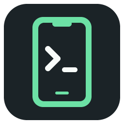
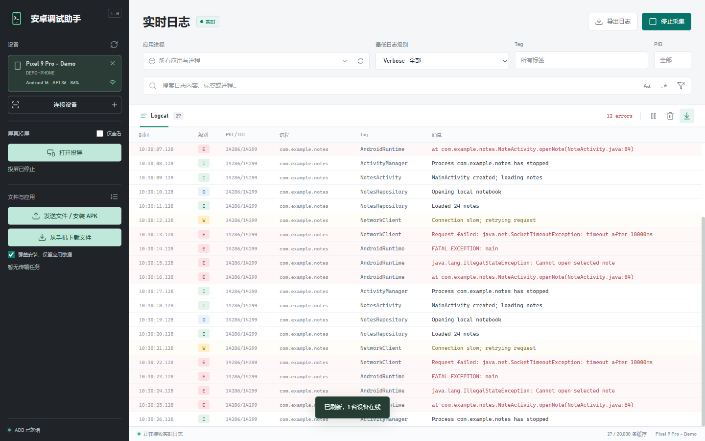
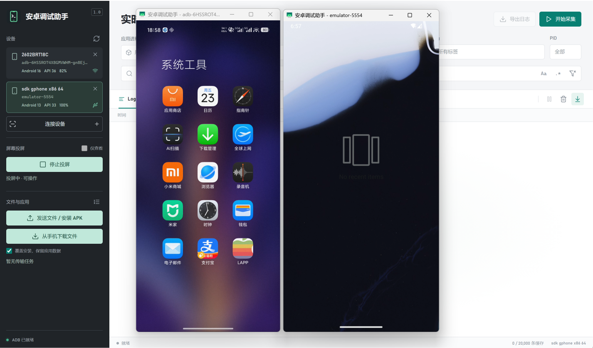
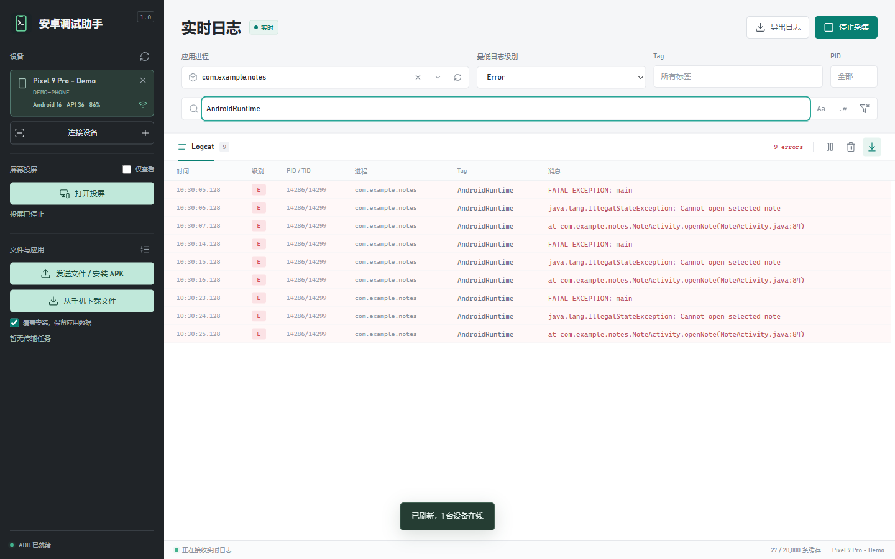
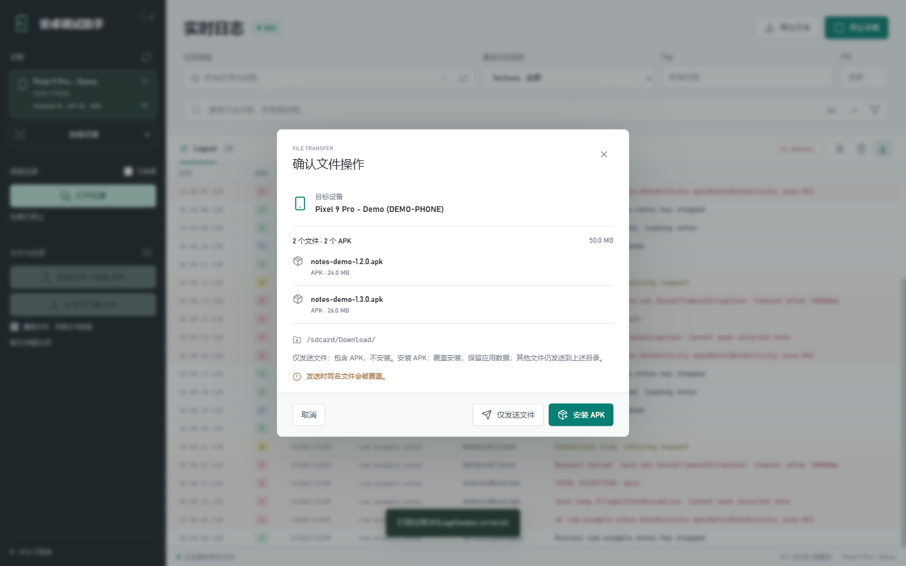
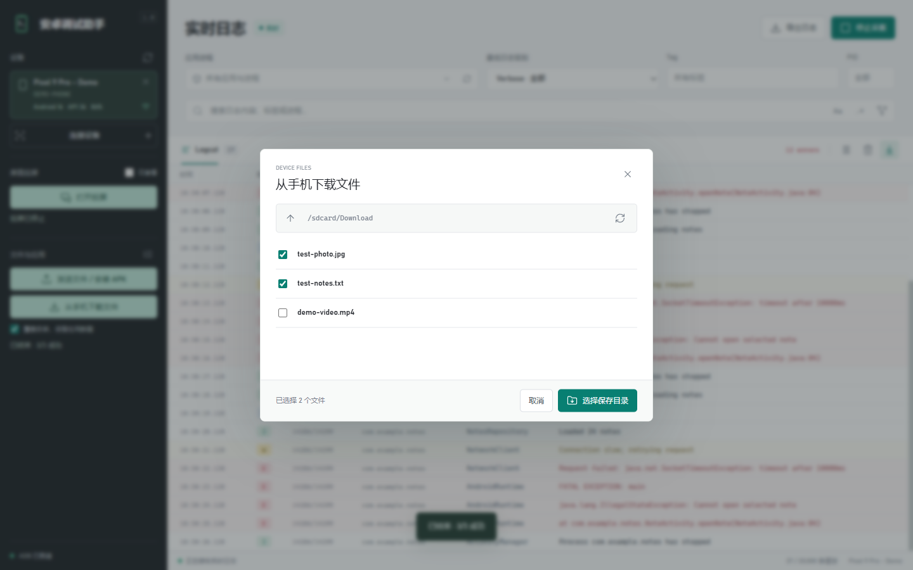
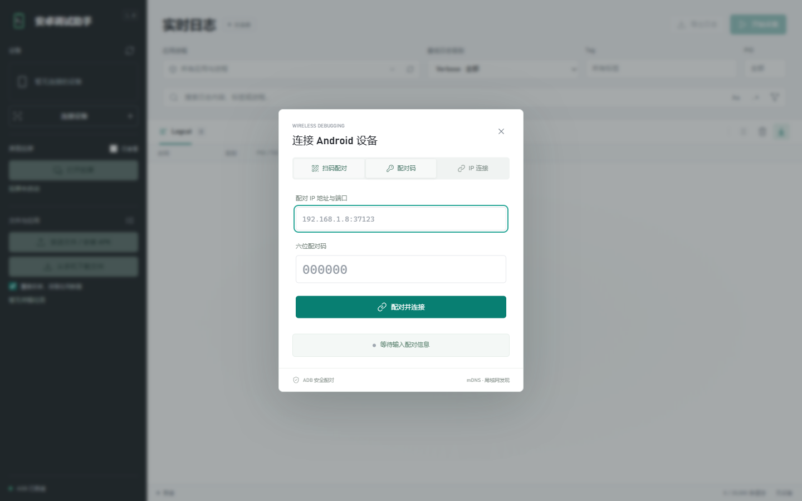

  

# 安卓调试助手：免费的多设备投屏与安卓日志查看工具

装个 APK 试试，结果一点开就闪退。你想把报错发给开发者，却先卡在了“日志从哪里看”这一步：翻教程、装 Android Studio、配环境、记 adb 命令，一圈下来，问题还没开始排查。

**安卓调试助手**把连接手机、看日志、装 APK、传文件、投屏这五件事放进了一个 Windows 窗口。免费使用，下载后即可连接手机，不需要 Java、SDK，也不用先成为安卓开发者。

[软件官网与下载](https://adb.leapever.com/) · [使用文档](https://adb.leapever.com/docs/intro)

<!-- truncate -->

> 本文截图取自软件实际界面，设备、应用与日志均为演示内容。

## 一个窗口，替代五个来回切换的工具

日常折腾安卓设备的人大概都经历过这些：

- 只想看一次崩溃日志，先下载几个 G 的 IDE，再学一遍 `adb logcat` 的过滤语法；
- 满屏日志一起滚动，找不出哪一行属于自己那个应用；
- 桌面上摆着三四台测试机，装包、传文件、投屏各用一个工具，每换一台就重新操作一遍；
- 给开发者反馈问题，只能发一张“应用已停止”的截图，对方还得反问：能不能给个日志？

安卓调试助手的思路很简单：**把常用操作集中到一个界面，设备信息、任务结果、日志内容全部可见**。窗口左侧是设备与功能入口，右侧是实时日志，装包和传文件的进度在队列里逐条显示，不用靠“手机桌面上有没有出现图标”来猜结果。

## 多台手机同时投屏，各自独立窗口

这是它最容易被低估的功能。绝大多数投屏工具一次只能看一台设备，切换设备就要断开重连；而在这里，**每台手机或模拟器都是一个独立窗口，可以同时开着、分别启停**。

- 连接多台手机、多个安卓模拟器，或手机与模拟器混用；
- 依次选中设备点击 **打开投屏**，已打开的窗口不会因为切换设备而关闭；
- 每台设备单独选择 **仅查看** 或鼠标键盘控制模式；
- 停止某台设备的投屏，不影响其他窗口，也不会中断日志采集。

做多机兼容性测试时，把几台手机的画面并排放在一起，同一个页面在不同机型上的表现一目了然；给客户演示时也不必再举着手机拍屏幕。

默认画面最大边长 1920，不传输手机音频，也不自动同步剪贴板。同时投屏的流畅度取决于电脑性能、设备编码能力和网络带宽，无线设备较多时改用 USB 连接会稳定不少。

## 日志不用“翻”，可以直接筛

连接手机后点击 **开始采集**，再在手机上重现问题。日志不是一次性拉取历史记录，而是随着操作实时进来——所以顺序很重要：**先开始采集，再复现问题**。

筛选条件可以叠加使用：

| 条件 | 怎么用 |
| --- | --- |
| 应用进程 | 输入部分包名即可实时缩小范围，选择包名时也包含其子进程 |
| 最低日志级别 | 选 Error 就只看严重错误，Warn 会同时显示 Error 和 Fatal |
| Tag / PID | 按标签片段或准确进程号定位 |
| 搜索 | 搜索日志内容、标签或进程，支持区分大小写与正则表达式 |

举个最常见的场景：应用包名是 `com.example.notes`，闪退了。在“应用进程”里输入 `com.example.notes`，最低级别切到 **Error**，必要时再搜 `AndroidRuntime`——屏幕上立刻只剩需要的那几行。点开一条记录看完整详情，右键复制原文，最后 **导出日志** 得到一份 UTF-8 文本，直接发给开发者。

几个容易踩的坑，软件本身也在界面上做了提示：

- 应用进程的候选项来自**当前已缓存的日志**，不是手机已安装应用列表。应用没产生日志就不会出现在候选里，别误以为筛选坏了。
- 最多缓存 20,000 条，超出后较早的记录会被淘汰。重要问题请及时导出，退出软件后未导出的日志不会保留。
- 暂停显示只冻结画面，采集还在继续；导出的是**当前筛选结果**，想导出全部请先重置过滤。

## APK 拖进窗口就能装

把 APK 拖到主界面，或者点击 **发送文件 / 安装 APK** 选择文件，然后在确认窗口核对目标手机和文件列表，点 **安装 APK** 即可。

- 支持一次选择多个 APK，按顺序逐个安装；
- 默认勾选 **覆盖安装，保留应用数据**，更新测试版本时不必重新登录、重新配置；
- 安装结果、失败原因都在传输队列里标明，不用靠手机桌面判断。

同一批次里可以混选 APK 和普通文件，但两个按钮的含义完全不同：点 **安装 APK** 时 APK 会被安装、其他文件只发送到手机；点 **仅发送文件** 时所有文件（包括 APK）都只是放进 Download 文件夹。这一点经常让人误以为“装了但没反应”。

覆盖安装不是万能的。签名不一致、版本降级、存储空间不足或厂商限制仍会失败，软件也不会替你卸载旧应用或清除数据。常见提示 `INSTALL_FAILED_USER_RESTRICTED` 通常需要在手机上允许安装，或开启厂商的“USB 安装”开关。

## 文件互传，两个方向都不用来回找

- **电脑 → 手机**：选择或拖入文件，确认后发送到 `/sdcard/Download/`。一次最多 100 个文件，不支持直接发送文件夹。
- **手机 → 电脑**：点击 **从手机下载文件**，浏览公共存储目录（Download、DCIM、Pictures 等），勾选多个文件后选择电脑保存位置。

传输队列会逐项显示等待、执行中、成功、失败，普通文件带百分比。**停止剩余任务** 只取消还没开始的，当前任务会先做完。

需要提醒的是：手机端同名文件会被覆盖，电脑保存目录也一样；浏览范围仅限手机公共存储，不会读取其他应用的私有数据，也不支持整目录下载。想统一查看进度和确认设备，请把文件拖进主界面，而不是独立投屏窗口。

## 连接方式：扫码、配对码、IP、USB 都支持

Android 11 及以上最省事：手机打开 **开发者选项 → 无线调试 → 使用二维码配对设备**，扫描电脑上的二维码即可。二维码有效期两分钟，过期点刷新重新生成。

不能扫码时，用手机配对弹窗里的地址、端口和六位配对码；已经配对过的设备，下次直接在 **IP 连接** 里填无线调试主页上显示的地址和端口。

注意两个端口的区别：配对弹窗里的端口用于首次配对，无线调试主页上的端口用于连接，两者通常不同，混用就会出现“配对成功却连不上”。旧版安卓或网络环境受限时，用数据线开启 USB 调试是最稳的方式。

设备连上后，左侧卡片会显示型号、安卓版本和电量。多台设备同时在线时，安装、发送文件和投屏前请先核对卡片——**任务始终发往确认时选中的那台手机，中途切换设备不会改变已排队任务的目标**。

## 五分钟上手

1. **下载安装**：Windows 10 / 11 64 位系统，安装包或免安装目录包均可。免安装包请完整解压后再运行“安卓调试助手.exe”，不要只移动主程序。
2. **准备手机**：在“关于手机”里连续点击版本号开启开发者选项，打开无线调试或 USB 调试，按提示完成授权。
3. **连接设备**：电脑点击 **连接设备 → 扫码配对**，手机用无线调试里的扫码入口扫描，等待设备出现。
4. **选一件事开始**：装 APK、传文件、看日志或投屏，四个入口全部在主界面。

如果只是想收集一次崩溃日志：开始采集 → 手机上复现 → 按包名和 Error 级别筛选 → 导出 → 发出去。

## 它适合谁

- **测试与售后**：把用户反馈的闪退复现成一份可读的日志，而不是一张截图；
- **独立开发者与外包**：不想为了临时看日志常驻一个 IDE；
- **多机兼容性验证**：几台手机、几个模拟器同时投屏对比；
- **运营与支持**：反复把测试包装到指定机型上，需要清晰的安装结果；
- **只拿到 APK 的普通用户**：好奇某个应用为什么闪退，想留下证据再联系作者。

## 它不做什么

安卓调试助手不替代 Android Studio，也不做代码级调试：断点、性能分析、布局检查这些仍然是 IDE 的活。它解决的是门槛问题——**把“临时看日志、装个包、传文件、同时看几台设备”从需要搭建环境的任务，变成点几下就能完成的操作**。

同样地，它不会绕过手机的安全策略：不能读取应用私有数据、不能解除受保护页面的投屏黑屏、不能强行覆盖签名不一致的应用，也不会自动修复任何错误。日志里有没有线索，最终还是取决于应用和系统实际输出了什么。

## 下载与相关链接

- 软件官网与下载：[https://adb.leapever.com/](https://adb.leapever.com/)
- 使用文档：[快速开始](https://adb.leapever.com/docs/quick-start) · [日志查看与导出](https://adb.leapever.com/docs/logs) · [手机投屏](https://adb.leapever.com/docs/screen-mirror) · [常见问题](https://adb.leapever.com/docs/faq)
- 联系邮箱：leapever@foxmail.com（微信 / QQ 客服见[官网联系方式](https://adb.leapever.com/docs/contact)）
- 开发者其他工具：[HTML 一键打包 APK 工具](https://html2apk.leapever.com/) · [恒盾 C# 混淆加密大师](https://csharpobf.leapever.com/)

软件免费使用。多设备投屏、日志导出、APK 安装与文件互传都不需要额外授权或付费解锁。

---

> 操作前请确认：仅连接你拥有或获准操作的设备；导出或分享日志前，检查其中是否包含账号、访问凭据等敏感信息。
